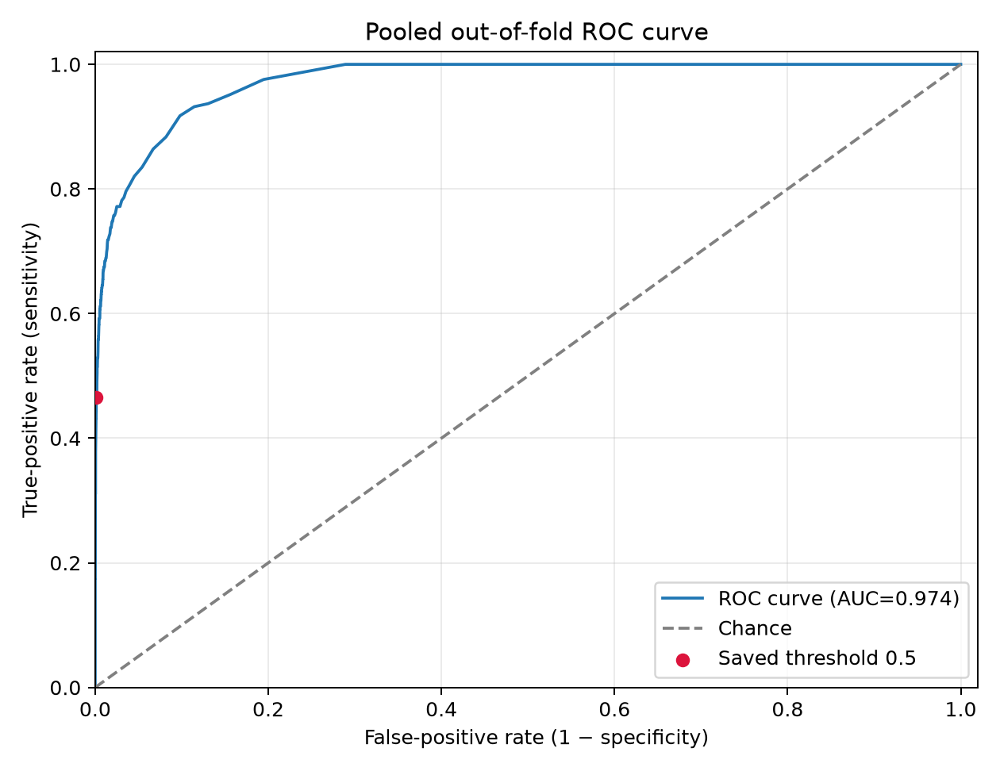
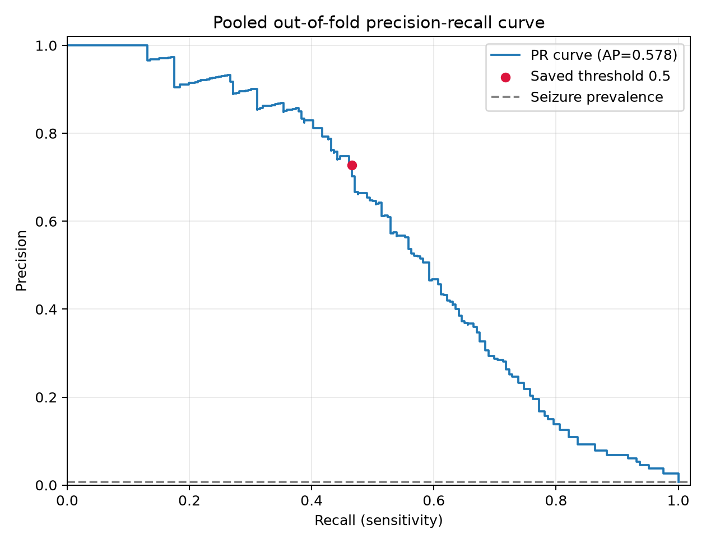
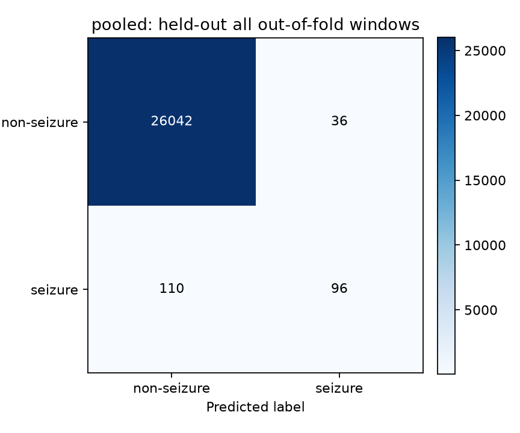

# EEG Seizure Detection

## Abstract

This project is an independent reconstruction and evaluation of an EEG seizure-detection pipeline using signal processing and Random Forest classification. The unavailable original implementation required explicit choices for signal conversion, window labels, feature definitions, and evaluation; these choices are documented as reconstruction decisions and are not presented as an exact reproduction of the published method.

On a selected CHB-MIT subset of 19 recordings from three patients, four-fold recording-held-out evaluation produced 46.60% sensitivity, 99.86% specificity, and 0.9742 ROC-AUC at a fixed 0.5 probability threshold. The high specificity and overall accuracy occur alongside low seizure-window sensitivity because seizure windows are rare.

## Project objective

The pipeline converts annotated scalp EEG recordings into window-level feature vectors and predicts whether each window overlaps an annotated seizure. The current model is a fixed-configuration Random Forest. It provides a reproducible exploratory baseline; it is not a clinical alarm system.

## Dataset

The source is the [CHB-MIT Scalp EEG Database](https://physionet.org/content/chbmit/1.0.0/). The evaluated local subset contains:

- 19 recordings from CHB01, CHB02, and CHB03.
- 8 seizure-containing recordings and 11 recordings without an annotated seizure.
- 26,284 evaluated windows: 206 seizure windows (0.78%) and 26,078 non-seizure windows.

Raw recordings, annotation sidecars, processed signals, feature matrices, predictions, and generated evaluation artifacts are excluded from this repository. The dataset must be obtained and used under its own access and license terms.

## Methods

### Signal and label processing

The pipeline inventories EDFs and patient summaries, checks available seizure sidecars, and preserves annotation validation status. Eligible EEG signals are converted in bounded chunks; source signals and units are not changed by the expanded baseline. The recordings are divided into 5-second windows with 50% overlap. A window is labeled seizure when it has positive-duration overlap with a validated seizure interval. This `any_overlap` rule is a reconstruction choice.

### Feature extraction

Features are computed per channel for each window:

- **Time domain:** mean, population standard deviation, maximum, and minimum.
- **Frequency domain:** dominant non-DC frequency, magnitude-weighted spectral centroid, total spectral power, and delta, theta, alpha, beta, and gamma band power.
- **Wavelet domain:** approximation and detail coefficient summaries from a level-3 discrete wavelet transform.

The evaluated feature configuration uses the project’s FFT and `db4` wavelet settings. Exact feature definitions, filter choices, and labeling rules not specified in the paper are reconstruction decisions and are described here rather than attributed to the paper.

### Classifier and validation

The baseline Random Forest uses 300 trees, Gini criterion, unrestricted depth, `min_samples_split=2`, `min_samples_leaf=1`, `max_features="sqrt"`, bootstrap sampling, `class_weight="balanced"`, random seed 42, and one worker. Exact duplicate feature columns are identified on each training fold only. No hyperparameters or threshold were tuned on held-out predictions. The classification rule is `P(seizure) >= 0.5`.

Evaluation uses four-fold stratified cross-validation at the **recording level**. Whole recordings are held out, stratified by recording-level seizure presence, and each recording appears in one test fold. The folds share patients across train and test partitions through different recordings. This is recording-held-out validation with patient overlap, not patient-independent validation.

## Results

Metrics below are pooled over the out-of-fold window predictions. Confusion matrix rows are actual class and columns are predicted class.

| Metric | Result |
|---|---:|
| Accuracy | 99.44% |
| Balanced accuracy | 73.23% |
| Sensitivity (recall) | 46.60% |
| Specificity | 99.86% |
| Precision | 72.73% |
| F1 score | 56.80% |
| ROC-AUC | 97.42% |
| Average precision | 57.76% |

| | Predicted non-seizure | Predicted seizure |
|---|---:|---:|
| **Actual non-seizure** | 26,042 | 36 |
| **Actual seizure** | 110 | 96 |

### Pooled out-of-fold ROC curve

The marker shows the saved model’s fixed 0.5 threshold. The curve summarizes score ranking across thresholds; the reported sensitivity and specificity use only the fixed threshold.



### Pooled out-of-fold precision-recall curve

The dashed line is seizure-window prevalence in this evaluation subset. Average precision is 0.5776.



### Pooled out-of-fold confusion matrix



### Interpretation

The ROC-AUC indicates strong ranking of positive windows in this selected sample, but it should be read alongside the fixed-threshold result: 110 of 206 seizure windows were missed. The dataset is highly imbalanced, so accuracy alone would overstate performance. A post-hoc analysis found that misses cluster within a few recordings and seizure intervals. A separate event-/recording-weighting comparison did not improve seizure-window sensitivity. Those observations are diagnostic and do not establish a cause or clinical value.

## Reproducibility

Use Python 3.10 or newer. The source data is not included.

```bash
python3 -m venv .venv
source .venv/bin/activate
python -m pip install -r requirements.txt
```

After placing the selected CHB-MIT patient folders, summaries, EDFs, and available sidecars under `data/raw/chbmit/`, build the manifest and process the local recordings:

```bash
python src/dataset_manifest.py \
  --dataset-root data/raw/chbmit \
  --output results/chbmit_dataset_manifest.csv

python src/process_chbmit.py

python src/assemble_feature_dataset.py \
  --corpus-manifest results/chbmit_dataset_manifest.csv \
  --state data/processed/corpus_pipeline/.process_chbmit_state.json \
  --output-dir data/processed/assembled_features \
  --chunk-rows 4096

python src/train_expanded_random_forest.py
```

The baseline reads the assembled matrix at `data/processed/assembled_features/chbmit_feature_dataset.csv` and writes results below `data/processed/evaluation/expanded_random_forest_baseline/`. Generated files and data remain local and are ignored by Git.

For the legacy CHB01 recording-wise baseline or the feature-family ablation, see `src/train_random_forest.py` and `src/feature_family_ablation.py`. Their results use a different, smaller evaluation and should not be combined with the expanded baseline.

## Limitations

- Only 19 recordings from three patients were evaluated; this is a small, selected subset of CHB-MIT.
- Patient overlap across folds prevents patient-independent generalization claims.
- Overlapping windows are correlated; window-level metrics are not independent-event estimates.
- Class imbalance yields high specificity and accuracy despite missed seizure windows.
- Results depend on reconstruction choices where the paper does not specify implementation details.
- This is an exploratory machine-learning evaluation, not a clinically validated detector.

## Reference

The project reconstructs methods described in [“Analysis and Detection of Seizures Using EEG Signal”](https://ieeexplore.ieee.org/document/10870633). The original implementation was unavailable. Results here are from this independent reconstruction and must not be interpreted as exact paper reproduction or a direct comparison with the paper’s reported scores.
